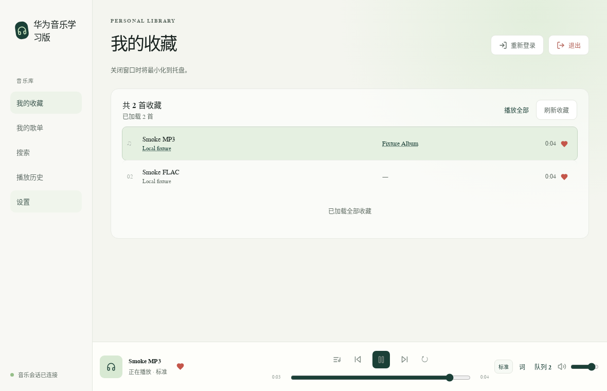
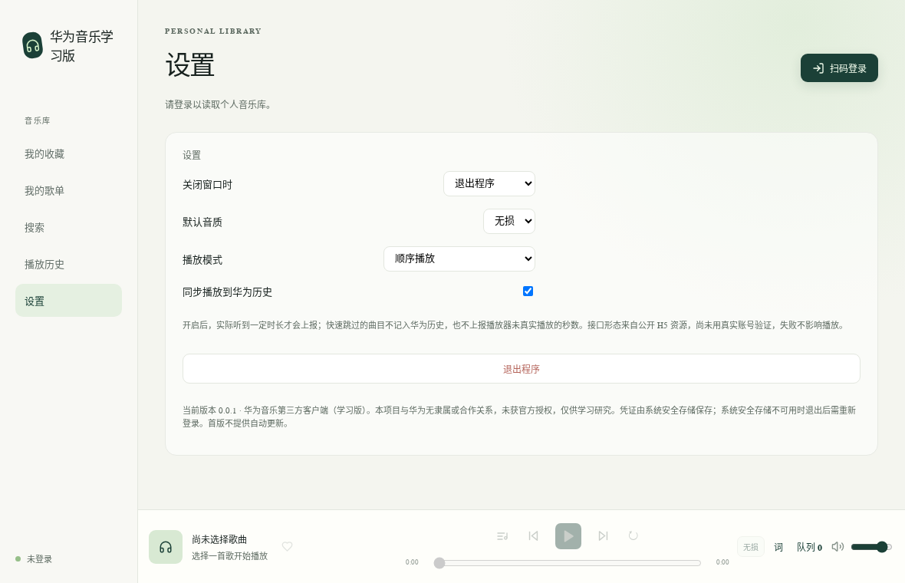
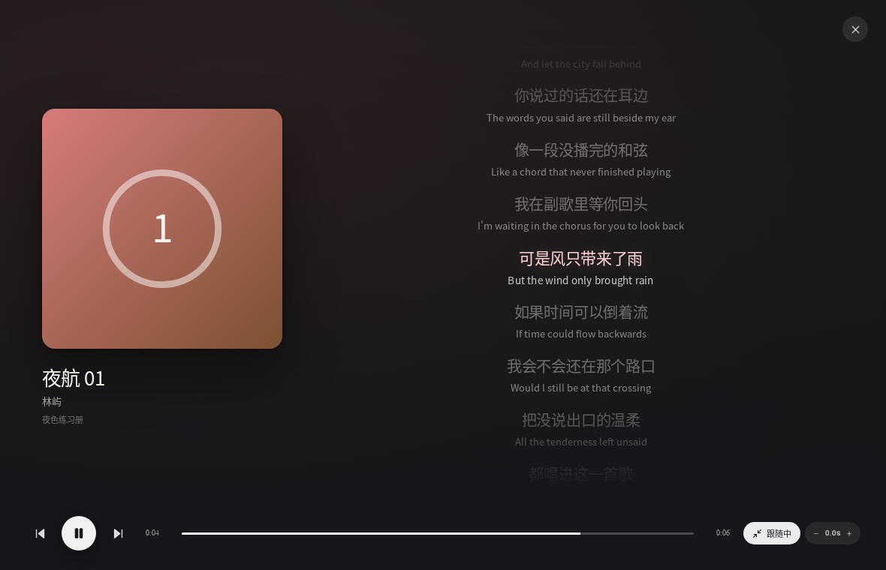
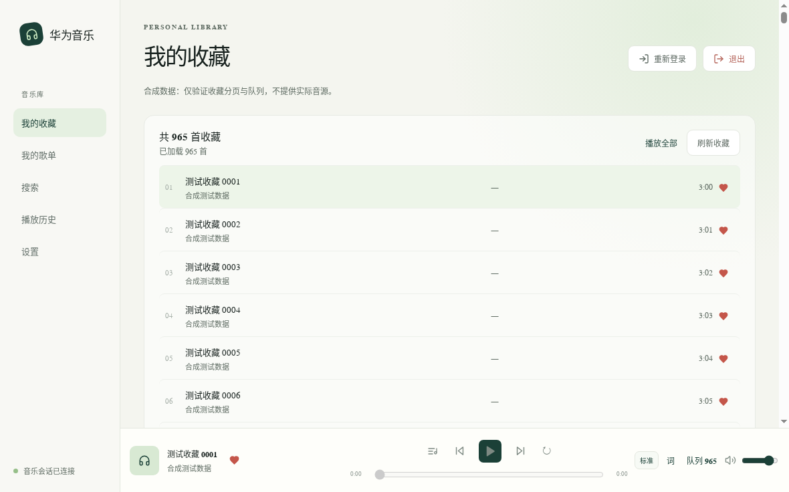

# himo

> **非官方项目**：与华为及其关联公司不存在隶属、合作或代理关系，未获官方授权、认可或技术支持，仅供学习研究。代码以 AGPL-3.0 授权，但公开分发安装包或商业使用前，请自行完成服务条款、应用身份与商标方面的合规评估。完整说明见[免责声明与使用边界](#免责声明与使用边界)。

本项目研究通过桌面客户端登录**你自己的**华为账号、读取音乐库，并按该账号实际权益请求华为音乐音源。仓库提供 Windows / macOS / Linux 构建入口，各平台与真实账号的验证范围见下表；接口可用性、账号权益和内容供应不由本项目控制。

开发范围不包括绕过付费、会员、地域或 DRM 限制，也不包括下载、解密、转存或离线导出。项目不授予音乐、歌词、封面、商标或服务接口的使用许可。

**English**: himo is an experimental, unofficial desktop client for Huawei Music, built with Electron + React + TypeScript. It explores access to your own account and library within your actual entitlements. Platform validation is limited; service availability is outside this project's control. Not affiliated with or authorized by Huawei. Code licensing does not grant rights to third-party services, trademarks or content; review the disclaimer before use or redistribution.

## 关于本 Fork

本仓库 [Govin-L/himo](https://github.com/Govin-L/himo) fork 自 [talongao/huawei-music-desktop](https://github.com/talongao/huawei-music-desktop)，以提交 [`3fd6731`](https://github.com/talongao/huawei-music-desktop/commit/3fd67319fa4b4a10de00d6da7d88e4e52ebd8327) 为分叉基线。感谢上游作者完成客户端、协议研究和基础工程。

本 Fork 自 2026-10-22 起独立维护，主要改动：

- 使用 himo 名称与定制应用图标，保留 macOS 单色菜单栏模板图与 Retina 适配。
- 增加独立透明桌面歌词，支持播放同步、拖动、锁定穿透、位置记忆和配色、描边、不透明度、字体等设置。
- 提供无需登录的合成曲库预览、自动重建与重启、本地检查命令和开发指南。
- 增加深色首页与「首页 / 我的」底部导航、独立播放条、歌词展开过渡与滚动收起交互；macOS 原生玻璃和开发版 Dock / 菜单栏图像有本机检查证据。
- 移除所有 CI 工作流，检查与打包在本地显式执行。

后续迭代以本 Fork 为准，上游改动按需手动同步，不以合并回上游为前提。保留原项目的版权、AGPL-3.0 许可和第三方归属，修改声明见 [NOTICE](NOTICE)。开发和同步步骤见 [开发指南](docs/DEVELOPMENT.md)。

仓库、应用和新构建产物统一使用 `himo` 标识。内部 `package.json.name`、应用 ID 和已有数据路径保留原值，不因品牌改名迁移设置与队列；登录状态的实际恢复仍取决于会话有效性和系统安全存储。上游项目名称用于来源与历史说明，服务名称用于说明兼容对象。

---

## 目录

- [关于本 Fork](#关于本-fork) · [当前状态](#当前状态) · [截图](#截图)
- [快速开始](#快速开始) · [开发](#开发) · [功能范围](#功能范围)
- [构建与打包](#构建与打包) · [测试](#测试)
- [架构与安全边界](#架构与安全边界) · [数据与隐私](#数据与隐私) · [已知限制](#已知限制与非目标)
- [参与贡献](#参与贡献) · [第三方组件](#第三方组件与致谢) · [许可](#许可) · [免责声明](#免责声明与使用边界)

## 当前状态

项目处于**早期实验阶段**：上游记录了 Linux 共享业务与播放器验证，本 Fork 增加了 macOS arm64 的界面、桌面歌词、原生玻璃和打包启动证据。下表按已记录的环境说明验证范围；构建、自动化回归或某次运行成功不等于跨平台完整验收，也不代表未来可用性、账号安全或内容授权。

| 能力 | 状态 | 证据 / 未验证 |
|---|---|---|
| 官方扫码登录、OAuth 回调、音乐会话 | 已在真实账号实测 | 本人扫码走完 CAS → OAuth → 音乐会话；登录页嵌入主窗口，远程页无 Node/preload/业务 IPC，取消与错误 state 的回归测试通过 |
| 凭据保存 | 部分验证 | 主进程 `safeStorage` 只存最小音乐会话；系统后端不可用或 Linux `basic_text` 时**只保留内存会话并提示**，不静默降级明文。真实系统密钥环下的跨进程恢复尚未验收 |
| 收藏 / 歌单 / 搜索 / 专辑 / 歌手 / 历史 | 已实现并回归 | 收藏支持总数统计与滚动分页；歌单 5 分钟进程内缓存，可手动刷新；真实账号只验证过首屏 50 首，完整 960+ 未逐页点验 |
| 播放器 | 已实现并回归 | 单 `Audio` 实例、队列、暂停/上下曲/拖动进度/音量、顺序·列表循环·单曲循环·随机播放、行级歌词与沉浸歌词页（切句、翻译、词级高亮、偏移）、音质选择；本地 MP3/FLAC 播放·seek·播完通过 |
| 华为音源真实播放 | **未验收** | 需要真实会员资源的 Electron 全曲播放证据，目前只有协议层与合成音频证据 |
| 写操作（收藏、建歌单、改简介、删自建歌单） | 协议层已实测，桌面路径未验收 | 写操作在主进程做归属校验、串行化、写后读回；不会盲重试 |
| 播放历史同步 | 代码已写，**未验证** | 按公开 H5 形态上报，达到收听阈值才报一次、秒数为实际收听、失败静默；真实账号效果未确认 |
| 托盘 / 关闭行为 / 媒体键 | 部分验证 | macOS arm64 菜单栏图标已验证；物理媒体键与其他平台待验收 |
| 三端安装包 | 部分验证 | Linux AppImage 保留历史证据；macOS arm64 有本地 DMG 构建与启动记录，具体安装修订见实现状态；Windows NSIS 与 macOS x64 未完成当前版本运行验收 |

更细的进度与证据见 [实现状态](docs/IMPLEMENTATION_STATUS.md)。

## 截图

> 以下是历史 Linux Electron 界面截图，展示**离线合成测试数据**，不是任何人的真实音乐库。当前 himo 的布局已调整，截图不代表当前版本外观或真实账号验收结果。

| 音乐库与播放栏 | 设置（二级分类 + 外观） |
|---|---|
|  |  |

| 沉浸歌词（封面 + 居中歌词） | 收藏总数与滚动分页（965 首合成数据） |
|---|---|
|  |  |

## 快速开始

需要 **Node.js 22.15+** 和一个可用的桌面环境（Linux 无头环境请用 `xvfb-run`）：

```sh
git clone https://github.com/Govin-L/himo.git
cd himo
npm ci
npm start
```

`npm start` 会先检查类型并构建，再启动本地 Electron；开发时使用下节的 `dev` / `dev:mock`。首次使用点击“扫码登录”，在**华为官方页面**完成扫码；核对页面显示的应用与权限后再决定是否授权。

- 以 root 运行时启动器会加进程级 `--no-sandbox`（仅开发便利），应用窗口自身仍启用 `sandbox` / `contextIsolation` / `webSecurity`。正式验收请用普通用户。
- 代理：主进程 HTTP、Chromium 登录/播放会读取进程级 `HTTP_PROXY` / `HTTPS_PROXY` / `ALL_PROXY` / `NO_PROXY`，**不修改系统代理**；暂不支持 SOCKS/PAC 与代理认证，配置无效时明确报错退出而不是直连。

## 开发

```sh
npm run dev:mock   # 免登录的离线开发：保存 src/ 后自动重建并重启
npm run dev        # 真实应用开发：在独立开发实例中自行登录
npm run preview    # 检查类型并构建一次，打开离线合成曲库供人工验收
npm run check      # 类型检查 + 全部 Node 离线单测
npm run verify     # check + 生产构建 + 桌面歌词 Electron 回归
```

开发循环使用生产构建文件，保存后重启整个应用，不是页面热更新；构建失败时保留正在运行的实例，修复并保存即可重试。开发目录与安装版数据分开，具体位置、调试入口、代码结构和贡献流程见 [docs/DEVELOPMENT.md](docs/DEVELOPMENT.md)。

## 功能范围

**当前实现（逐平台验证范围以上表为准）**

- 登录：官方页面扫码、取消登录、退出账号；会话失效时提示重新登录。
- 音乐库：收藏（总数 + 滚动分页）、我的歌单与详情、搜索歌曲、专辑与歌手详情、华为播放历史（只读）。
- 外观：主题色（5 种预设 + 取色器自定义）、面板透明度、圆角、字号、系统已安装字体均可调，立即生效并随设置持久化；歌词页有沉浸式全屏视图。
- 歌词：优先使用服务端返回的歌词；没有时用「歌名 + 艺人 + 时长」在第三方歌词库（酷狗音乐、LRCLIB）严格匹配，匹配不准则保持无歌词，可在设置关闭。只请求歌词文本，不涉及音源。
- 歌词缓存与导入：按曲目缓存 90 天（设置里可查看占用、一键清除），并支持导入本地 `.lrc` / `.txt`（UTF-8 / UTF-16 / GBK 自动识别），本地导入优先于任何在线结果。
- 播放：单实例播放器、队列（可持久化，不保存播放地址）、进度拖动、音量与静音、顺序/列表循环/单曲循环/随机播放、行级歌词、标准/无损选择（按服务端实际返回展示，不虚标）。歌词支持句级高亮、点击跳转、双语翻译并排、词级逐字高亮（源文件提供时），以及全屏沉浸页与按曲记忆的 ±0.5s 时间轴校正。
- 写操作：收藏增删、创建自建歌单、修改简介、删除自建歌单（仅对当前账号已确认的 `owned` 歌单）。
- 系统集成：托盘与关闭行为设置、系统媒体控制、媒体键。
- 桌面歌词：播放栏「桌面歌词」按钮打开独立置顶的透明描边字幕；解锁时可直接拖动，悬停显示字号、锁定和关闭工具栏。锁定后隐藏工具栏并穿透鼠标，回到主播放栏点击「解锁桌面歌词」即可恢复操作。位置、字号与锁定状态随设置保存，重启后恢复；换屏幕后超出工作区的位置会自动收回。同步歌词、翻译、词级高亮（源文件提供时）、播放/暂停/缓冲、切歌、进度跳转与歌词偏移；超长句随播放进度平移，主窗口隐藏后继续跟随。关闭浮窗不影响播放。
- 其它：离线只读缓存（网络失败时显示并标注“可能不是最新”）、本机播放记录与华为历史分开显示。

**明确不做**（首版非目标）

每日推荐、私人 FM、离线下载、音频解密、Audio Vivid / 空间音频、Hi-Res 承诺、无缝播放与交叉淡化、均衡器、单文件免安装版、移动端、云同步、自动更新服务、其它平台音源。

## 构建与打包

通用前提：Node.js 22.15+。所有打包命令都显式 `publish: never`，不会自动上传或发布。

### 1. 编译产物

```sh
npm run build          # typecheck + electron-vite build → out/{main,preload,renderer}
```

### 2. Windows：NSIS 安装包

```sh
npm run dist:win                 # → release/win-x64/*.exe（NSIS 安装包）
```

- 产物是 NSIS 安装程序：双击进入安装向导，可自选安装目录；不创建桌面快捷方式，从开始菜单启动。
- 必须在**原生 Windows** 上构建：安装包的资源编辑与图标工具链依赖 Windows。项目不再提供单文件免安装便携版，也没有 Linux 交叉构建的 Windows 产物。
- 静态校验：`npm run test:windows-installer -- <setup.exe>`，检查 NSIS 标记、内嵌 x64 应用、无私人目录/源码、图标像素，以及与当前 `out/` 逐文件一致。校验不执行安装程序。
- **未签名**：可能被 SmartScreen 或企业策略拦截，请自行核对 SHA-256，不要为此关闭系统安全防护。
- 卸载入口为“应用和功能”，配置不主动删除应用数据；Windows 当前版本的覆盖安装、卸载及数据恢复仍需本机验证，不能将配置视为数据保留保证。

### 3. Linux：AppImage（可选 deb）

```sh
npm run dist:linux               # → release/linux-x64/*.AppImage
```

- AppImage 直接运行；`.deb` 需要真实的主页与维护者身份，通过环境变量提供，缺失时只产出 AppImage，不编造元数据：

```sh
DESKTOP_BUILD_HOMEPAGE=https://example.com \
DESKTOP_BUILD_MAINTAINER='Name <mail@example.com>' \
npm run dist:linux
```

- 校验实际产物（从 AppImage 内提取二进制并隔离启动，不读默认用户目录）：

```sh
npm run test:packaged -- release/linux-x64/himo-0.0.1-linux-x86_64-internal.AppImage
```

### 4. macOS：DMG

```sh
npm run dist:mac:arm64           # 或 dist:mac:x64，必须在 macOS 上运行
```

macOS arm64 有本地 DMG 构建与启动记录，具体源码修订和安装状态见 [实现状态](docs/IMPLEMENTATION_STATUS.md)；x64 尚未完成当前版本运行验收。当前不提供 Apple Developer ID 签名或公证保证，必须区分本地 ad-hoc 签名与开发者签名；不为安装关闭 Gatekeeper 或移除隔离属性。

### 5. 发行内容与校验和

```sh
npm run test:release-contents    # 按 build.files 白名单模拟打包，断言不含 .local/、research/、docs/、test/、scripts/、src/
node scripts/release-checksums.mjs release/<dir>   # 生成 SHA256SUMS（不自动上传）
```

当前构建命令仅在本地产出文件，不自动上传或发布。公开仓库、源码许可或本地生成安装包均不表示已取得第三方服务、应用身份、商标或内容的分发授权；公开分发需单独核查相应条件。

## 测试

```sh
npm test                        # 离线单测（协议、状态机、缓存、播放决策）
npm run typecheck
npm run build
npm run test:electron           # 真实 Electron：渲染边界、本地音频播放/seek/播完、媒体与代理边界
npm run test:electron-ui        # 真实 Electron 页面回归：单 Audio、收藏写回、歌词/队列、设置、跨进程持久化
npm run test:desktop-lyrics     # 透明桌面歌词：播放同步、锁定/解锁、设置跨进程恢复及窗口隔离，无需 ffmpeg
npm run test:electron-business  # 只替换登录页与 HTTP 传输，跑生产 AuthManager/IPC：读写、缓存、退出清理
npm run test:electron-favorites # 965 首合成库：总数、滚动分页、失败重试、切页位置、完整队列
npm run test:login-callback     # 离线 OAuth 导航回归（不扫码、不兑换令牌）
npm run test:release-contents   # 发行白名单与 asar 内容检查
```

平台要求与边界：

- Linux 无头环境需要 `xvfb-run`（测试启动器会自动使用，并隔离 fontconfig 缓存以避免中文方框）。Windows / macOS 直接使用当前桌面会话。
- Smoke/UI 音频测试需要 `ffmpeg` 生成合成音频；独立桌面歌词测试直接生成静音 WAV，不依赖 `ffmpeg`。
- 以上命令都**不登录任何账号**、不读取 `.local/`。可选的真实账号复验单独走 `npm run test:login-live -- --login`，只在本人明确准备扫码时执行。

## 架构与安全边界

```text
Electron 主进程
  华为 API / 官方登录页宿主 / safeStorage / JSON 持久化 / 托盘与窗口
        │  白名单 IPC（结构化请求与结果）
preload：window.desktop 固定方法
        │
React 渲染进程（本地文件）
  页面、队列、单个 Audio、歌词、系统 Media Session
```

三条不可放宽的边界：

1. **凭据与业务 HTTP 只在主进程**；渲染进程只能调用固定白名单 API，拿不到音乐 Token 或账号 Token。
2. **官方登录页没有应用权限**：它作为 `WebContentsView` 嵌在主窗口内（不是第二个窗口），但独立 partition、无 preload、无 Node、无业务 IPC，权限请求与下载一律拒绝；取消只走 `auth:cancelLogin`。
3. **不关闭 `webSecurity`、不放宽 TLS 校验、不注册全局 `hms://` 协议、不修改系统代理**。

目录结构：

| 路径 | 职责 |
|---|---|
| `src/main/` | 主进程：登录宿主、业务请求、存储、IPC、托盘、窗口 |
| `src/preload/` | 唯一的 `window.desktop` 桥 |
| `src/renderer/` | React 页面、播放器、歌词、样式 |
| `src/shared/` | DTO、错误类型、IPC 通道常量、显示名 |
| `src/*.mjs` | 独立协议实现（OAuth/PKCE、音乐接口、歌词解析），可在 Node 下直接测试 |
| `test/` | 离线单测 |
| `scripts/` | 打包、校验、Electron 集成测试（不进入发行包） |
| `docs/` | 方案、接口契约、验证记录 |
| `.local/`、`research/` | 私人凭据与研究现场，**不提交、不打包**（已在 `.gitignore`） |

## 数据与隐私

- 用户数据（设置、队列、本机播放记录、加密会话）保存在 Electron 的 `userData` 目录，不在程序目录里；退出账号会清除本机个人数据，通用设置保留。
- 只保存完成后续请求所需的**最小音乐会话**（音乐 Token、本人音乐用户标识、到期字段），账号 AT/RT 不落地。
- 系统安全存储不可用（含 Linux `basic_text`）时**不写盘**，只保留内存会话并明确提示；不设置 `setUsePlainTextEncryption`。
- 无遥测、无崩溃上报、无自动更新检查；日志不写 URL query、请求体、原始响应、Authorization 或曲目私人标识。
- 播放地址只作为当次播放结果交给渲染进程，不写日志、不写队列文件、不持久化。
- 本项目不读取开发者机器上的私人会话，也不在运行时导入任何外部凭据。
- 第三方歌词（默认开启，可在「设置 → 播放」关闭）：仅当服务端没有返回歌词时，把**歌名、艺人、专辑名、时长**发送给酷狗音乐与 LRCLIB 的公开接口做匹配，不发送账号、令牌、设备标识或播放记录。接口非本项目所有，可用性与匹配质量不受控。
- 歌词缓存位于 `userData/lyrics-cache`（网络结果，90 天）与 `userData/lyrics-local`（本地导入），只含曲目标识与歌词文本，不含账号信息；退出账号不删除，可在「设置 → 播放」清除。

## 已知限制与非目标

- Windows 和 macOS x64 尚未完成当前版本真机验收；macOS arm64 的界面、桌面歌词、原生玻璃及打包启动检查不能替代真实账号、完整播放或所有系统集成的验收。
- 华为音源的真实 Electron 全曲播放（标准与无损）仍待授权验证；协议层解码证据不能替代它。
- 音乐会话是另一种凭据（到期字段提示约 7 天，未实测到期的完整周期）；标准 refresh 流程未打通，真正失效后需要重新扫码，本项目不会每小时强制登录。
- 歌单编辑只提供已验证的“简介修改”，不提供改名/封面/曲目增删的假按钮。
- 第三方歌词依赖公开接口，命中率有限（尤其冷门/版权下架的华语歌）；匹配不到时界面会明确显示「暂无歌词」，不会用别的歌顶替。
- 每日推荐接口目前不可用（HTTP 400），首版不做。
- 登录使用的 OAuth 应用标识（`client_id` = `101444301`）**不是本项目注册的身份**。它来自一篇第三方公开帖（吾爱破解的华为音乐下载工具，配套仓库 `Tontonnow/hwyy`）；该帖只公开了带此 id 的授权链接，**没有说明获取方式**。我们自己的抓取显示：`101444301` 同时是华为音乐在 AppGallery 的应用 ID（`appgallery.huawei.com/#/app/C101444301`），官方注册的回调 scheme 也是 `com.huawei.apps.101444301:/oauth2redirect`，因此它极可能是**华为音乐官方 App 自身的 OAuth 身份**，而非可供第三方使用的注册应用。这意味着：该 id 随时可能失效；用它登录会把流量记在官方应用名下；把它随客户端分发涉及服务条款与身份冒用问题。许可证不解决这一点，本项目也不对此作出任何授权承诺。

## 参与贡献

欢迎 Issue 与 PR，但请先确认方向属于本项目的合法使用范围：

- **不接受**绕过付费/会员/地域/版权限制、音频解密、接口滥用、批量抓取，或引入其它音乐平台音源、账号代理、云端转发的改动。
- 修复缺陷、改进可访问性与中文排版、补充测试、提升跨平台兼容性是受欢迎的方向。
- 开发环境和流程见 [开发指南](docs/DEVELOPMENT.md)。提交前运行 `npm run verify`，并按改动范围补选集成测试；涉及界面或播放器的改动提供对应的验证证据。
- 不要提交 `.local/`、`research/`、真实账号数据、Token、Cookie 或抓包内容；测试请使用合成数据。
- 涉及真实账号的写操作验证由维护者本人在明确授权下执行，不接受通过 PR 自动运行。

## 第三方组件与致谢

- 运行时/框架：Electron、React、undici；界面图标使用 [Lucide](https://lucide.dev)（ISC）。himo 应用图标源图为 `build/himo-icon-source.png`，`scripts/make-icon.mjs` 生成应用/托盘 PNG 与单色菜单栏标记；素材及保留的上游归属说明见 [`build/icon.LICENSE.txt`](build/icon.LICENSE.txt)。
- 本 Fork 继承 [talongao/huawei-music-desktop](https://github.com/talongao/huawei-music-desktop) 的代码与研究成果，未另引入其他音乐客户端源码。接口兼容性研究记录见 [接口契约](docs/API_CONTRACT.md) 与 [验证记录](docs/authorized-feature-validation.md)。

## 许可

代码以 **GNU Affero General Public License v3.0（AGPL-3.0-only）** 授权：完整条款见 [`LICENSE`](LICENSE)，版权与第三方归属见 [`NOTICE`](NOTICE)。Copyright (C) 2026 本项目作者。

- 本仓库代码的复制、修改和再分发受 `LICENSE` 的完整条件约束，包括适用的版权/许可声明保留及对应源码提供义务。涉及修改版本的远程网络交互时，另须核对 AGPL 第 13 条的适用要求；本段摘要不替代许可原文。
- 本项目不提供代码许可之外的授权，不作适销性、特定用途适用性、持续维护或无侵权保证；第三方组件各自的许可和权利声明仍适用。
- **许可证只覆盖本仓库的代码**。它不授予：华为服务的接口使用权、华为音乐内容的使用权、“华为 / HUAWEI / 华为音乐”等名称与商标的使用权，也不代表任何官方身份或与华为的合作关系。登录所用 OAuth 应用标识不属于本项目（见[已知限制](#已知限制与非目标)）。
- 如需在商业或公开发布场景使用，请先自行完成服务条款、应用身份与商标方面的合规审查；必要时咨询律师。

## 文档索引

| 文档 | 内容 |
|---|---|
| [开发指南](docs/DEVELOPMENT.md) | 开发命令、源码入口、检查与手动同步上游 |
| [实现状态](docs/IMPLEMENTATION_STATUS.md) | M0–M6 进度、当前验证范围与阻塞项 |
| [实现方案](docs/IMPLEMENTATION_PLAN.md) | 目标架构、页面行为、阶段验收标准 |
| [接口契约](docs/API_CONTRACT.md) | 已验证的接口参数与常见陷阱 |
| [授权验证记录](docs/authorized-feature-validation.md) | 本人授权下的功能实测与清理结果 |
| [登录回调修复](docs/LOGIN_CALLBACK_FIX.md) | 扫码登录导航问题的定位与修复 |
| [待验证清单](docs/token-lifetimes-and-renewal.md) | 凭据期限与续期探索 |
| [历史流水](docs/IMPLEMENTATION_HISTORY.md) | 过程记录；与当前状态冲突时以状态文档为准 |

## 免责声明与使用边界

> **himo 是基于所注明上游代码独立维护的非官方实验性客户端，与华为及其关联公司不存在隶属、合作或代理关系，未获得其官方授权、认可或技术支持。仓库公开和采用 himo 标识不构成第三方权利许可、官方身份或合规结论。**

- **商标与内容权利**：“华为”“HUAWEI”“华为音乐”等名称及相关商标归各自权利人所有，在此仅用于说明所兼容的服务，不表示官方身份或背书。歌曲、录音、歌词、封面及其它服务内容的权利归各自权利人所有；本项目不提供这些内容的所有权或再分发许可。
- **合法使用前提**：仅在适用法律、相关服务协议及实际授权允许的范围内，使用本人合法持有的账号访问有权使用的内容。个人研究、非商业用途、购买会员或能够成功调用接口，均不当然意味着已获准使用第三方客户端、接口或分发相关软件。
- **禁止用途**：不得利用本项目绕过付费、会员、地域、版权或技术保护限制；不得破解、下载后转售或未经许可传播受保护内容；不得盗取账号、收集他人凭据、滥用接口、未经授权批量抓取数据，或搭建面向公众的音源解析、转发及商业服务。
- **接口与登录身份**：本项目不是华为提供的 SDK，也不代表获得了接口使用许可。登录使用的 OAuth 应用标识（`client_id` = `101444301`）不是本项目注册的身份：它来自第三方公开帖，且据我们观察极可能是华为音乐官方 App 自身的应用身份。技术上登录或播放成功不构成授权证明，该标识也可能随时失效，并可能触及服务条款与身份冒用问题。公开源代码、发布安装包或商业化之前，仍须核查服务条款、应用身份、商标与内容权利，并取得必要许可。
- **使用风险与保证限制**：项目处于实验阶段，接口可能变更或停止服务，也可能发生功能错误、账号限制、数据丢失或安全问题。在适用法律允许的范围内，项目按现状提供，不承诺持续可用、适合特定用途、绝对安全或不涉及第三方权利，也不承诺维护期限、响应时限、后续功能或特定修复。不要将其用于关键业务，不要向维护者发送密码、Cookie、授权码或令牌。
- **权利反馈**：权利人可通过 [仓库 Issue](https://github.com/Govin-L/himo/issues) 或托管平台联系渠道提供具体说明与权利依据。请勿公开提交个人信息或凭据；这一联系入口不构成响应时限或处理结果的承诺。

**本声明不是法律意见，也不替代必要授权，更不能保证免除法律责任或避免权利主张。** 有意公开分发时，请先咨询熟悉软件、网络服务及知识产权事项的律师。

## 社区

感谢 [LINUX DO](https://linux.do/) 社区。
